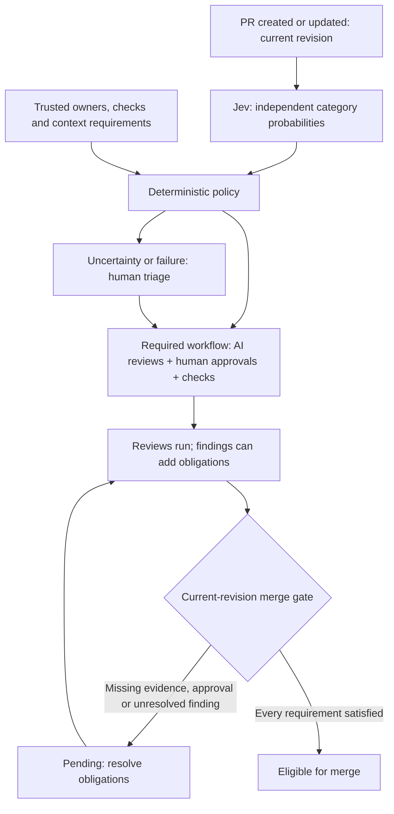

# From category probabilities to a completed review

**The concrete change is real; the percentages and completion events below are illustrative test fixtures. They are not Jev measurements or human approvals.** The gate outcomes were executed locally against those fixtures.

Consider the historical [OpenEMR payment change](https://github.com/openemr/openemr/commit/2ab074e827b9), development case D05. The supplied diff changes a patient-record access path, queries and dynamic output, and includes gateway credential handling. The study supplies the extracted diff and touched-file context at that same revision.

The router asks eight independent questions about that changed behavior. It preserves each Noul answer and displays its percentage. In this illustrative example:

| Condition | Stored probability | Display | Policy consequence |
|---|---:|---:|---|
| Personal-data access changes | 0.96 | 96% | Privacy approval, data-flow AI review, secret scan |
| Authorization boundary changes | 0.93 | 93% | Boundary-owner approval, boundary AI review, boundary tests |
| Patient/tenant scoping changes | 0.91 | 91% | Same boundary obligations, deduplicated |
| SQL construction changes | 0.94 | 94% | SQL security AI review and SAST |
| Commands, parsers or dynamic output change | 0.88 | 88% | Construction security AI review and SAST |
| Sensitive-data flow changes | 0.95 | 95% | Same privacy/data obligations, deduplicated |
| Security configuration changes | 0.12 | 12% | No additional configuration obligation from this signal |
| Supplied context is insufficient | 0.10 | 10% | No model-triggered context escalation; trusted context assessment still controls |

**96% means an estimated probability that the stated access-change condition applies. It does not mean severity or safety.** The percentages here are invented to demonstrate the declared policy, not calibrated confidence claims.

Personal-data access and authorization both cross their category-specific thresholds, so policy adds **AppSec approval**. SQL construction also crosses its threshold, so policy adds **specialized SQL AI review**. These requirements apply together. Existing peer approval and tests remain required regardless of every percentage.

The combined workflow requires four human approvals: peer, AppSec, privacy owner and boundary owner. It also requires four configured AI reviews: SQL, boundary, data flow and construction. Required checks are the existing tests, boundary checks, SAST and secret scan. Overlapping signals do not create duplicate tasks.

For SQL review, the selected configuration specifies an exact model snapshot, a SQL-security prompt, historical files, database schema, query helpers, read-only tools and structured findings output. This specifies what must run; it does not establish that the selected model is best. The fixture model is approved only within the simulation, and no downstream model was executed.

The actual gate results in [gate-scenarios.json](examples/gate-scenarios.json) show the distinction:

| Executed local scenario | Gate result |
|---|---|
| Clean AI reports, but no AppSec approval | Blocked |
| Required AI review incomplete | Blocked |
| Security check incomplete | Blocked |
| Approval belongs to an earlier revision | Blocked |
| Required AppSec reviewer unavailable | Blocked |
| SQL signal lies in its uncertainty interval | Blocked pending triage |
| Routing request failed | Blocked pending triage |
| Blocking finding unresolved | Blocked |
| All configured reviews, checks and approvals complete for this revision | Eligible, simulated only |

For these scenarios, context completeness and reviewer availability are explicit fixture assumptions. They are not established facts about the historical PR. In a real workflow, missing database context keeps SQL review incomplete; a low model estimate of missing context cannot override that. A new commit invalidates prior-revision completion evidence. A clean AI report cannot supply AppSec approval, and recording triage cannot complete a review.

**Observed routing:** no live calls with these eight questions yet. The original pilot remains evidence only for its original configuration. **Simulated enforcement:** nine local gate scenarios executed, with eight blocked and one eligible. **Untested:** independent workflow accuracy, best-model selection, downstream vulnerability detection, actual reviewer effectiveness and CI/CD enforcement. Independent human security adjudication and threshold review are required before the nine-case holdout runs.

The practical lesson is that probabilities help select obligations; verified completion determines merge eligibility.
